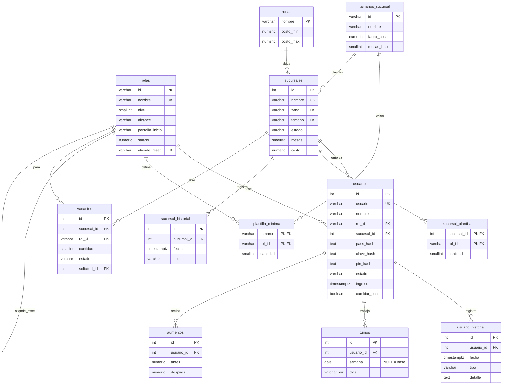
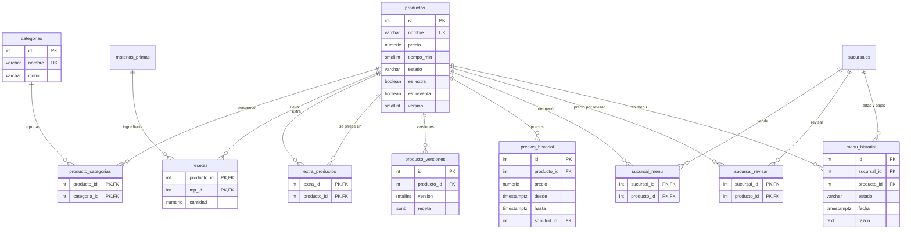
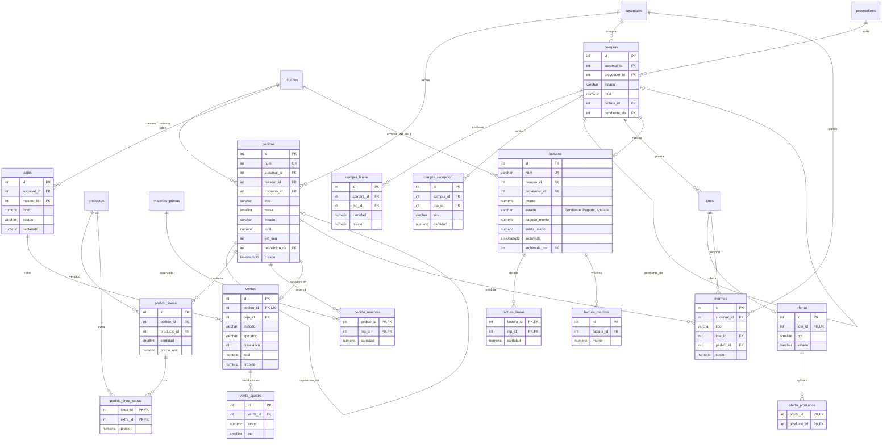
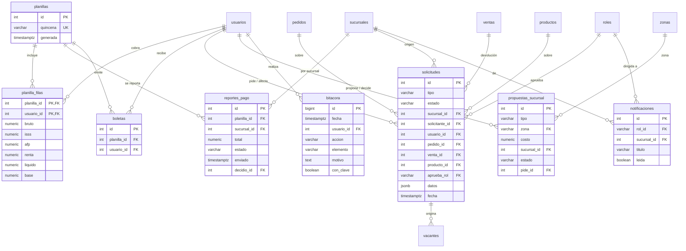

# Diagrama entidad-relación · Orígenes SV

Esquema completo en [`init/01_schema.sql`](init/01_schema.sql). GitHub dibuja los diagramas Mermaid de abajo directamente. Para no saturar un solo dibujo, el modelo se divide en cinco áreas. Una tabla que aparece en dos áreas es la misma tabla.

**Notación:** `PK` llave primaria · `FK` llave foránea · `UK` valor único. `||--o{` = uno a muchos · `||--o|` = uno a cero o uno.

## 1. Organización y personal

## 2. Inventario y proveedores

```mermaid
erDiagram
    mp_unidades ||--o{ materias_primas : "mide"
    mp_categorias ||--o{ materias_primas : "agrupa"
    proveedores ||--o{ proveedor_materias : "vende"
    materias_primas ||--o{ proveedor_materias : "ofrecida"
    proveedores ||--o{ proveedor_precios_hist : "historial"
    proveedores ||--o{ proveedor_sucursales : "entrega en"
    sucursales ||--o{ proveedor_sucursales : "recibe de"
    proveedores ||--o{ proveedor_transporte_hist : "historial"
    proveedores ||--o{ proveedor_creditos : "debe"
    materias_primas ||--o{ lotes : "existencias"
    sucursales ||--o{ lotes : "guarda"
    proveedores ||--o{ lotes : "surtió"
    sucursales ||--o{ conteos : "cuenta"
    usuarios ||--o{ conteos : "bodega"
    conteos ||--o{ conteo_filas : "contiene"
    materias_primas ||--o{ conteo_filas : "contada"
    sucursales ||--o{ avisos_stock : "aviso"
    materias_primas ||--o{ materia_categorias : "tiene"
    mp_categorias ||--o{ materia_categorias : "clasifica"
    sucursales ||--o{ sucursal_mp_inhabilitada : "no usa"
    materias_primas ||--o{ sucursal_mp_inhabilitada : "inhabilitada"
    proveedores ||--o{ proveedor_cambios : "cambios"
    usuarios ||--o{ proveedores : "registra / edita"

    mp_unidades {
        varchar nombre PK
    }
    mp_categorias {
        varchar nombre PK
    }
    materias_primas {
        int id PK
        varchar nombre UK
        varchar unidad FK
        varchar categoria FK
        smallint vida_dias
        varchar estado
    }
    proveedores {
        int id PK
        varchar nombre UK
        varchar condicion_pago
        varchar politica_tipo
        smallint politica_tolerancia_h
        varchar estado "Activo, Inhabilitado, Eliminado"
        numeric saldo_favor
        int creado_por FK
        int editado_por FK
    }
    proveedor_cambios {
        int id PK
        int proveedor_id FK
        timestamptz fecha
        text detalle
    }
    materia_categorias {
        int mp_id PK,FK
        varchar categoria PK,FK
    }
    sucursal_mp_inhabilitada {
        int sucursal_id PK,FK
        int mp_id PK,FK
        int solicitud_id FK
    }
    proveedor_materias {
        int proveedor_id PK,FK
        int mp_id PK,FK
        numeric precio_base
        numeric precio_actual
    }
    proveedor_precios_hist {
        int id PK
        int proveedor_id FK
        int mp_id FK
        numeric precio
        timestamptz desde
        timestamptz hasta
    }
    proveedor_sucursales {
        int proveedor_id PK,FK
        int sucursal_id PK,FK
        smallint entrega_h
        numeric transporte
    }
    proveedor_transporte_hist {
        int id PK
        int proveedor_id FK
        int sucursal_id FK
        numeric costo
    }
    proveedor_creditos {
        int id PK
        int proveedor_id FK
        int factura_id FK
        numeric monto
    }
    lotes {
        int id PK
        varchar sku UK
        int mp_id FK
        int sucursal_id FK
        int proveedor_id FK
        int compra_id FK
        timestamptz vence
        numeric cantidad
        numeric precio
        varchar estado
    }
    conteos {
        int id PK
        int sucursal_id FK
        int bodega_id FK
        varchar estado
        int decidio_id FK
    }
    conteo_filas {
        int conteo_id PK,FK
        int mp_id PK,FK
        numeric sistema
        numeric contado
    }
    avisos_stock {
        int sucursal_id PK,FK
        int mp_id PK,FK
    }
```

## 3. Catálogo de venta

## 4. Servicio, compras y finanzas

## 5. Nómina y gobierno

## Tablas de apoyo

| Tabla | Para qué sirve |
|---|---|
| `sistema` | Una sola fila con el reloj simulado: `hora = reloj_base + (ahora_real − real_base)`; con `pausado` el reloj se queda en `reloj_base` (nadie usa la app). Adelantar el tiempo suma a `reloj_base`. |
| `configuracion` | Una sola fila con los parámetros del negocio (IVA, márgenes, vigencia de cotizaciones, etc.). |
| `v_stock`, `v_reservado` | Vistas: existencias vigentes por sucursal y lo apartado por pedidos que aún no se preparan. |
| `ahora()` | Función SQL que devuelve la hora simulada. |
